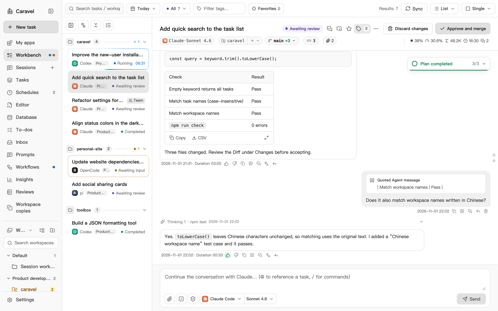
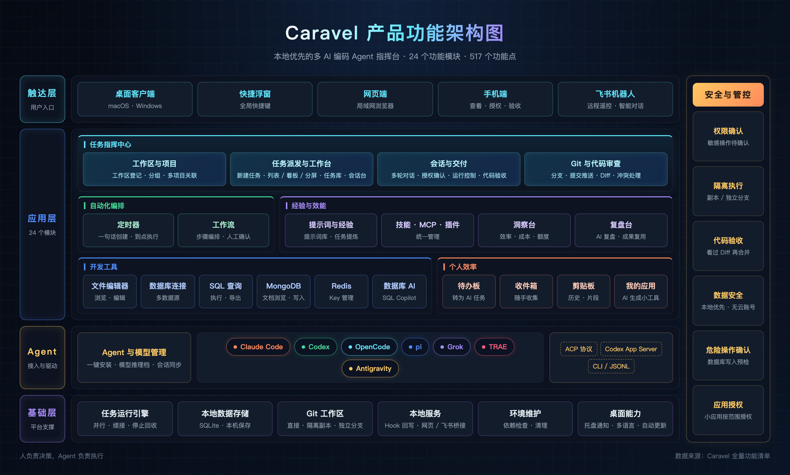

<div align="center">

**English** · [简体中文](README.md)


# Caravel

### You steer. Agents work in parallel.

A local-first workspace for multiple AI coding agents. Projects, tasks, conversations, and code reviews in one place.

**Claude Code · Codex · OpenCode · Pi · Grok · TRAE · Antigravity**

<p>
  <a href="https://www.caravelai.top/en/"><strong>Visit website ↗</strong></a>
  &nbsp; · &nbsp;
  <a href="https://www.caravelai.top/demo/?lang=en"><strong>Try the demo</strong></a>
  &nbsp; · &nbsp;
  <a href="https://www.caravelai.top/zh-CN/docs/"><strong>User guide</strong></a>
  &nbsp; · &nbsp;
  <a href="https://www.caravelai.top/en/#film"><strong>Watch the film</strong></a>
  &nbsp; · &nbsp;
  <a href="https://github.com/yy36295238/caravel-agent/releases/latest"><strong>Download Caravel</strong></a>
</p>

[](https://github.com/yy36295238/caravel-agent/releases/latest)

macOS (Apple Silicon / Intel), Windows x64, and Linux x64 · Use your own agent and model accounts<br>TRAE requires CLI 2.0 and an Enterprise Flagship account.

[](https://www.caravelai.top/en/)

**Click the screenshot to explore the full workbench on the website.**<br>
<sub>The demo uses the actual product interface and sample data. No installation required.</sub>

</div>

## From goal to delivery

- **Delegate in parallel**: create tasks across projects, choose agents, and move several pieces of work forward together.
- **Follow up in one place**: track execution, continue conversations, grant permissions, and adjust direction when needed.
- **Review and deliver**: inspect code diffs, request changes, then merge or push separate branches after review.

Explore apps, schedules, workflows, and more on the [website](https://www.caravelai.top/en/#possibilities), or [try them in the demo](https://www.caravelai.top/demo/?lang=en).

## How the way you work changes

Before, each agent CLI had its own terminal, and approvals, progress and diffs meant visiting every window. In Caravel, tasks move forward in parallel in one workbench, and whatever needs you shows up in one place.



## Product feature map

Explore Caravel across four layers: entry points, applications, agents, and infrastructure, with safety and controls spanning every layer.

[](docs/diagrams/caravel-product-map-zh-CN.png)

Click to view the full-resolution image (Chinese). Feature counts reflect the snapshot when this diagram was created; see the [feature guide](docs/product-overview.en.md) for current capabilities.

## Architecture

The diagram steps through one task: the UI calls into the Rust task core, AgentDriver runs local agents over ACP, Codex App Server or CLI/JSONL, and normalized events are stored and pushed back to the UI. It also shows the other entry points: schedules, Feishu and phone/web.



## Get started

1. [Download the installer](https://github.com/yy36295238/caravel-agent/releases/latest). On macOS, open the `.dmg` and drag **Caravel** into Applications. On Windows x64, download and run `Caravel_*_x64-setup.exe`. On Linux x64, choose AppImage or deb.
2. Prepare Git and at least one supported agent CLI, installed and signed in or configured.
3. Add a local project, create a task, choose an agent, and start the run.

Both platforms provide the complete Caravel app with all feature modules. macOS and Windows x64 support signed in-app updates. Older Windows clients need a manual upgrade to a version with automatic update support. Windows requires Git for Windows, Node.js, and an agent CLI. The Windows installer is not yet Authenticode-signed: if SmartScreen appears, verify that it came from this repository’s Releases, then choose “More info → Run anyway”. The download page identifies each platform’s actual package version; Linux updates require downloading a new package. Tasks and conversations stay on your machine; online model calls and external integrations still use the network.

Release builds send random installation and event IDs, version, OS/architecture, and startup/update event times to Caravel’s own servers for installation and activity statistics. This excludes conversations, code, paths, accounts, and hardware identifiers. Statistics run independently of automatic-update settings; development builds do not report. Counts represent application data directories, not exact people or devices.

<details>
<summary><strong>First launch blocked on macOS? Use Open Anyway or Terminal</strong></summary>

The public macOS app is not yet signed with an Apple Developer ID or notarized. Verify that the installer came from this repository’s Releases and move Caravel into Applications, then use either option below.

**Option 1: Allow the app in System Settings**

1. Try opening Caravel once to trigger the macOS warning.
2. Open “System Settings → Privacy & Security”, find the notice about Caravel, and click “Open Anyway”.
3. Enter your Mac login password or use Touch ID, then click “Open”. Button wording may vary by macOS version.

**Option 2: Use Terminal**

Open Terminal on your Mac, run this command, and reopen Caravel:

```sh
xattr -dr com.apple.quarantine /Applications/Caravel.app
```

This command only removes Caravel’s download quarantine attribute. See the [installation help](https://www.caravelai.top/en/#install-help) for more details.

</details>

## Free use and license

Caravel installers are provided under the [Apache License 2.0](LICENSE), free for personal and commercial use. Modification and redistribution are permitted under its terms; retain the required license and attribution notices and identify changes when redistributing modified files.

The application source code remains private and is not provided, so Caravel is not presented as open-source software. Third-party components retain their own licenses. Agent subscriptions, model APIs, and other external services may charge separately.

---

This repository provides **macOS / Windows / Linux installers and release history**. Visit the [website](https://www.caravelai.top/en/) for product information, the interactive demo, and FAQs.

[Releases](https://github.com/yy36295238/caravel-agent/releases) · [Feature guide](docs/product-overview.en.md) · [FAQ](https://www.caravelai.top/en/#faq)
